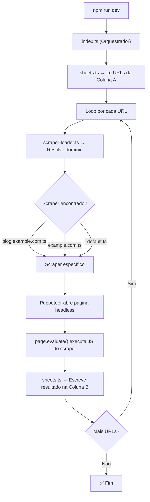

# Web Scraper — Google Sheets + Puppeteer

## Resumo

Projeto TypeScript completo para web scraping integrado com Google Sheets. O script lê URLs de uma planilha, aplica scrapers customizados por domínio usando Puppeteer, e escreve os resultados de volta na planilha.

## Arquivos Criados

### Configuração

| Arquivo | Propósito |
|---|---|
| [tsconfig.json](file:///c:/Users/Caio%20DEV/Desktop/DEV/OUTROS/TESTES/web-scrap/tsconfig.json) | Config TypeScript (ES2020, CommonJS) |
| [package.json](file:///c:/Users/Caio%20DEV/Desktop/DEV/OUTROS/TESTES/web-scrap/package.json) | Dependências e scripts npm |
| [.env.example](file:///c:/Users/Caio%20DEV/Desktop/DEV/OUTROS/TESTES/web-scrap/.env.example) | Modelo de variáveis de ambiente |
| [.gitignore](file:///c:/Users/Caio%20DEV/Desktop/DEV/OUTROS/TESTES/web-scrap/.gitignore) | Ignora credenciais, dist, node_modules |

### Código-fonte (`src/`)

| Arquivo | Propósito |
|---|---|
| [index.ts](file:///c:/Users/Caio%20DEV/Desktop/DEV/OUTROS/TESTES/web-scrap/src/index.ts) | Orquestrador principal — lê URLs → abre Puppeteer → executa scrapers → escreve resultados |
| [config.ts](file:///c:/Users/Caio%20DEV/Desktop/DEV/OUTROS/TESTES/web-scrap/src/config.ts) | Lê `.env` e exporta config tipada |
| [sheets.ts](file:///c:/Users/Caio%20DEV/Desktop/DEV/OUTROS/TESTES/web-scrap/src/sheets.ts) | Autenticação via Service Account + leitura/escrita na planilha |
| [scraper-loader.ts](file:///c:/Users/Caio%20DEV/Desktop/DEV/OUTROS/TESTES/web-scrap/src/scraper-loader.ts) | Resolve e carrega scrapers por domínio dinamicamente |
| [types.ts](file:///c:/Users/Caio%20DEV/Desktop/DEV/OUTROS/TESTES/web-scrap/src/types.ts) | Interfaces `ScraperFunction` e `ScraperModule` |

### Scrapers (`scrapers/`)

| Arquivo | Propósito |
|---|---|
| [_default.ts](file:///c:/Users/Caio%20DEV/Desktop/DEV/OUTROS/TESTES/web-scrap/scrapers/_default.ts) | Scraper fallback — extrai `document.body.innerText` |
| [example.com.ts](file:///c:/Users/Caio%20DEV/Desktop/DEV/OUTROS/TESTES/web-scrap/scrapers/example.com.ts) | Exemplo de scraper específico por domínio |

### Documentação

| Arquivo | Propósito |
|---|---|
| [README.md](file:///c:/Users/Caio%20DEV/Desktop/DEV/OUTROS/TESTES/web-scrap/README.md) | Guia completo de setup, uso e criação de scrapers |

## Arquitetura

## Fluxo de Resolução de Scrapers

Para a URL `https://blog.example.com/post/123`:

1. Extrai domínio: `blog.example.com`
2. Busca `scrapers/blog.example.com.ts` → se existir, usa
3. Senão, busca `scrapers/example.com.ts` → se existir, usa
4. Senão, busca `scrapers/_default.ts` → fallback
5. Se nenhum existir → erro com instruções

## Validação

- ✅ TypeScript compila com zero erros (`npx tsc --noEmit`)
- ✅ Todas as dependências instaladas

## Próximos Passos para o Usuário

1. Criar a Service Account no Google Cloud e gerar o `credentials.json`
2. Copiar `.env.example` para `.env` e preencher o `SPREADSHEET_ID`
3. Compartilhar a planilha com o email da Service Account
4. Criar scrapers customizados na pasta `scrapers/` para cada domínio
5. Executar com `npm run dev`
